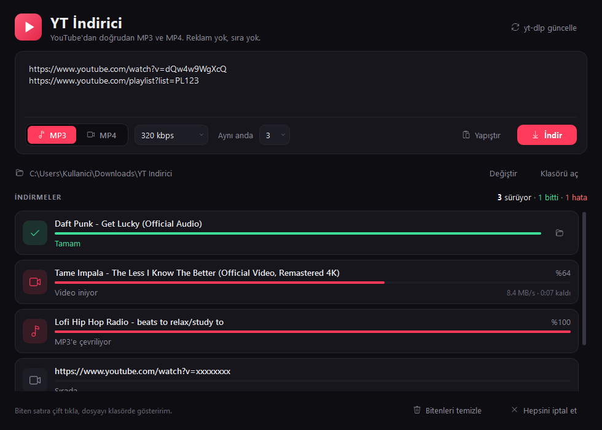

# YT İndirici

YouTube'dan doğrudan **MP3** ve **MP4** indiren, Windows için sade bir masaüstü uygulaması.

Web dönüştürücüler videoyu önce kendi sunucularına indirip orada çevirir, sonra sana gönderir. YT İndirici dosyayı
YouTube'dan doğrudan indirir, çevirme işini de senin bilgisayarında ffmpeg yapar. Reklam, sıra ve ikinci indirme yok.

## Özellikler
- Birden çok link aynı anda; playlist ve kanal linkleri tek tek videolara açılır
- Aynı anda 1–6 indirme
- MP3: 320 / 256 / 192 / 128 kbps, kapak resmi ve etiketler dosyaya gömülür
- MP4: En iyi, 2160p … 360p; aynı çözünürlükte en uyumlu codec (H.264 + AAC) seçilir
- İptal, kaldığı yerden yeniden deneme, `yt-dlp güncelle` düğmesi
- GoodbyeDPI gibi DPI aşma araçlarının bozduğu bağlantılarda otomatik yeniden deneme

## Kurulum ve kullanım
1. **[YT-Indirici.zip indir](../../releases/latest/download/YT-Indirici.zip)** (her zaman son sürüm) ve zip'i bir klasöre aç.
2. `Baslat.bat`'a çift tıkla.

İlk açılışta eksikleri kendisi kurar (bir kere, birkaç dakika):
- **Python 3.12** yoksa python.org'dan indirir (SHA-256 doğrulamalı, yönetici izni gerekmez)
- **ffmpeg** yoksa uygulama klasörüne `ffmpeg\bin` olarak indirir (SHA-256 doğrulamalı)
- `.venv` sanal ortamını ve paketleri (`requirements.txt`) kurar

Sonraki açılışlar anında olur. Linkleri kutuya yapıştır, MP3 ya da MP4 seç, **İndir**'e bas (ya da Ctrl+Enter).
Dosyalar varsayılan olarak `İndirilenler\YT Indirici` klasörüne iner.

## Sorun giderme
- **İndirme birden bozulduysa:** YouTube bir şeyi değiştirmiş olabilir, sağ üstteki **yt-dlp güncelle**'ye bas.
- **Uygulama açılmıyorsa:** klasördeki `hata.log`'a bak. `.venv` klasörünü silip `Baslat.bat`'ı yeniden çalıştırmak kurulumu sıfırlar.
- **Başka bilgisayara taşırken** `.venv` klasörünü kopyalama; başlatıcı onu her bilgisayarda kendisi kurar.

## Geliştirici notları
- `YTI_DRYRUN=1` kurulumu yapar, uygulamayı açmaz
- `YTI_TEST_NOFFMPEG=1` sistemdeki ffmpeg'i yok sayar (indirme yolunu test eder)

## Yasal not
Bu araç yalnız kişisel kullanım içindir. İndirdiğin içeriğin telif haklarına ve YouTube Hizmet Şartları'na uymak
senin sorumluluğundadır.

## Lisans ve teşekkür
Kod [MIT](LICENSE) lisanslıdır. Kullandığı kütüphaneler kendi lisanslarıyla gelir:
[yt-dlp](https://github.com/yt-dlp/yt-dlp) (Unlicense), [PyQt6](https://www.riverbankcomputing.com/software/pyqt/) (GPL v3),
[FFmpeg](https://ffmpeg.org/) (GPL; [gyan.dev](https://www.gyan.dev/ffmpeg/builds/) derlemesi), [Deno](https://deno.com/) (MIT).
